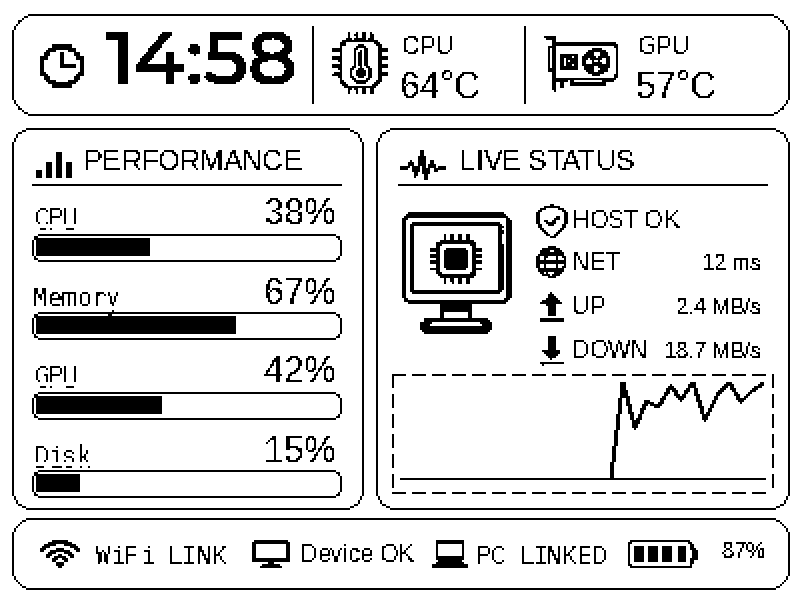
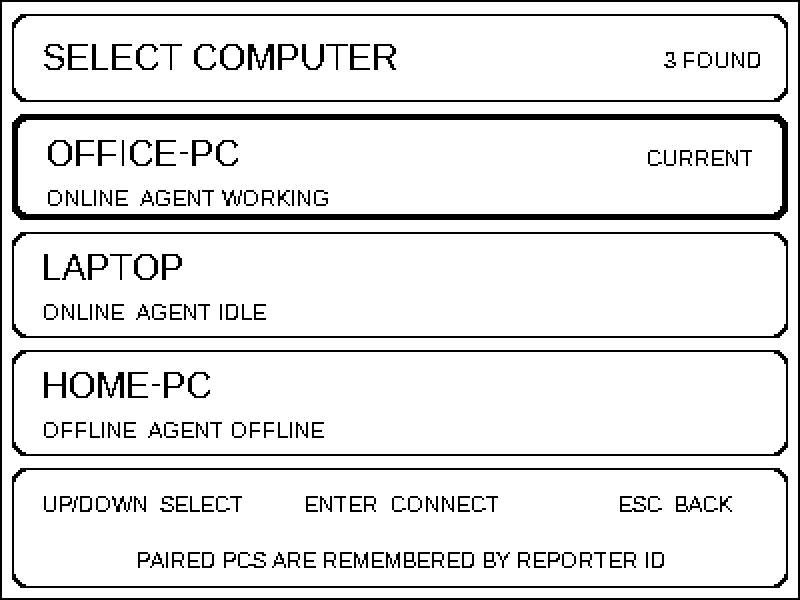
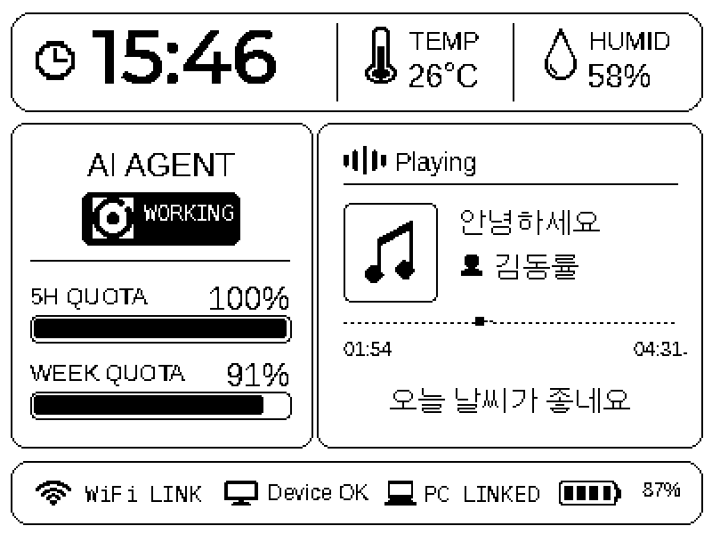
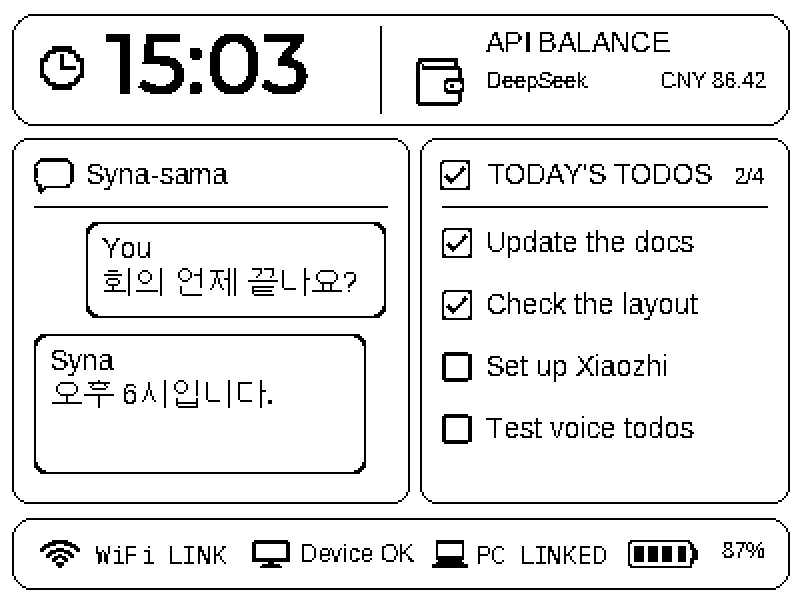

# Syna

<p align=center>
  
</p>

Waveshare ESP32-S3-RLCD-4.2 데스크톱 어시스턴트와 Windows / macOS Reporter 동반 프로그램입니다.

현재 버전: **1.0.0 릴리스 후보**.

## 기능 및 지원 범위

- 보드에서 컴퓨터 성능, 에이전트 상태 및 쿼터, 음악 정보를 표시합니다.
- LAN에서 컴퓨터를 검색하고 바인딩할 컴퓨터를 선택하며, 업그레이드 후에도 설정이 유지됩니다.
- Windows 올인원 설치 프로그램은 Reporter 전용, 설정 유지 업그레이드, 최초 설치의 세 가지 모드를 제공합니다.
- 현재 펌웨어는 한 번의 문답마다 한 번씩 웨이크업하며, 응답 중에는 음성 인터럽트를 받지 않습니다. 컴파일과 플래싱은 완료되었으며, 실제 음성 사용감은 아직 검증이 필요합니다.
- 음악 타이밍은 현재 추정 로직을 사용하므로, 정확한 실시간 진행률이 보장되지는 않습니다.
- **스피커 출력이 아직 정상 아닙니다.** 마이크, STT, 서버 TTS 수신, Opus 디코딩, 코덱 기록까지는 정상이나, 스피커에서 소리가 나지 않습니다. 확인된 범위와 남은 가설은 [음성 출력 진단](docs/AUDIO_OUTPUT_DIAGNOSIS.md)에 정리했습니다.

하드웨어 타깃은 ESP32-S3-RLCD-4.2이며, 16 MB 플래시와 8 MB PSRAM을 탑재했습니다. 다른 모델에는 펌웨어를 플래싱하지 마세요.

## 사용법

정식 릴리스 후에는 프로젝트 Releases에서 맞는 시스템 설치 프로그램을 받으세요. 이 소스 디렉토리에는 설치 프로그램, 런타임 환경, 기기 설정이 포함되어 있지 않습니다.

Windows 사용자는 설치 프로그램을 연 뒤, 보드에 이미 이 프로젝트의 펌웨어가 있으면 "설정 유지 업그레이드"를 선택하고, 컴퓨터 측만 필요하면 "Reporter 전용"을 선택하세요. "최초 설치"는 보드의 기존 데이터를 지우므로 진행 전에 확인하세요. 플래싱 중에는 USB 연결을 유지하고, 인수 확인이 끝날 때까지 백업을 보관하세요.

Windows 컴퓨터 측 설치와 설정 유지 플래싱은 작성자 본인의 기기에서 인수 확인을 마쳤습니다. macOS는 별도 구현으로 이전에 검증된 바 있으나, 이번 Windows 변경 사항에 대해서는 다시 검증하지 않았습니다.

## Xiaozhi 음성 설정

Xiaozhi 콘솔은 **음성 대화**를 담당합니다. 화면의 CPU·메모리 그래프나 MiniMax 잔액은 이 클라우드 경로와 별개입니다.

1. 보드 최초 부팅 후 화면 안내에 따라 기기 핫스팟(`Syna-0721`)에 연결하고, 안내된 설정 페이지(`http://192.168.4.1`)를 열어 사용 가능한 Wi-Fi를 설정하세요. 컴퓨터 바인딩과 Wi-Fi 설정은 기기 페이지에서 완료됩니다.
2. 브라우저에서 https://xiaozhi.me/ 를 열고 로그인한 뒤 "콘솔"로 들어갑니다.
3. 콘솔에서 기기를 추가하고, 보드 화면에 표시된 활성화 코드를 입력해 본인 계정 또는 에이전트에 바인딩하세요. 이미 바인딩된 기기는 먼저 원래 계정에서 조회하세요. 플래시를 지운다고 클라우드 바인딩이 반드시 해제되는 것은 아닙니다.
4. 기기와 연결된 에이전트에서 "역할 설정"을 열어 역할 페르소나, 음성, 페이지에서 제공하는 모델 옵션을 설정하고 저장한 뒤 다시 웨이크업해 테스트하세요. 반영되지 않으면 기기를 재시작하세요.
5. 바인딩이 완료되면 보드 상태가 `activating → idle` 로 바뀌며, 재부팅 후에도 유지됩니다.

활성화 코드가 없으면 먼저 기기가 이미 온라인인지 확인하세요. 이미 정상적으로 대화할 수 있는 기기는 대개 다시 활성화할 필요가 없습니다. 콘솔 항목 이름은 웹 페이지에 실제 표시되는 대로 따릅니다.

자세한 내용: [Xiaozhi 설정 가이드](docs/XIAOZHI_SETUP.md).

## MiniMax 잔액 설정

MiniMax API 키를 넣으면 **화면의 잔액 표시**가 채워집니다. AI 음성 대화는 여전히 Xiaozhi 클라우드를 쓰므로 MiniMax로 바뀌지 않습니다.

보드 설정 페이지의 **API Balance** 항목에서 아래처럼 입력하세요.

| 항목 | 값 |
| --- | --- |
| Provider Display Name | `MiniMax` |
| API Base URL | `https://api.minimax.io/v1` |
| API Key | MiniMax에서 발급한 키 (저장하면 공란으로 표시됨) |
| Balance Fetch Method | `Custom HTTP endpoint` |
| Balance Endpoint URL | `https://api.minimax.io/v1/token_plan/remains` |
| Request Method | `GET` |
| Authentication | `Bearer` |
| Header / Parameter Name | `Authorization` |
| Balance JSON Path | `model_remains[0].current_weekly_remaining_percent` |
| Fixed Unit | `%` |
| Numeric Scale | `1` |
| Unit JSON Path | 비움 |
| POST JSON | 비움 |

**Balance JSON Path의 대괄호 인덱스가 중요합니다.** MiniMax 응답은 `model_remains` 배열을 반환하므로 `model_remains.current_weekly_remaining_percent` 가 아니라 `model_remains[0].current_weekly_remaining_percent` 여야 합니다. 인덱스를 빼면 값을 못 읽어 화면에 `--` 로만 표시됩니다.

응답 형식은 다음과 같습니다.

```json
{
  "base_resp": { "status_code": 0, "status_msg": "success" },
  "model_remains": [
    { "model_name": "general", "current_weekly_remaining_percent": 43 }
  ]
}
```

설정을 저장하면 보드가 주기적으로 잔액을 조회해 화면에 `MiniMax % 43` 형태로 표시합니다. `DeepSeek official preset` 은 DeepSeek 전용 프리셋이므로 MiniMax에는 `Custom HTTP endpoint` 를 선택하세요.

## Reporter 연결

<p align=center>
  
</p>

화면의 CPU·메모리 그래프와 네트워크 수치는 컴퓨터 측 Reporter가 제공합니다.

Reporter는 UDP 브로드캐스트로 보드를 찾으므로 **보드와 같은 L2 네트워크**에 있어야 합니다. 서로 다른 서브넷에 두면 검색되지 않습니다. 공유기를 쓰는 경우 보드와 컴퓨터를 모두 2.4 GHz 대역의 같은 공유기에 연결하세요.

Reporter는 HTTP `8765`, 검색 포트는 UDP `8766` 을 사용합니다. macOS에서는 `reporter/start.command`, Windows에서는 `reporter/start.ps1` 로 실행합니다.

### macOS 로그인 시 자동 실행

`reporter/macos_service.py` 로 부팅 시 자동 실행을 등록합니다.

```bash
cd reporter
.venv-macos/bin/python macos_service.py install   # 등록 + 시작
.venv-macos/bin/python macos_service.py status    # 상태 확인
.venv-macos/bin/python macos_service.py stop      # 중지 (다음 로그인 때 다시 시작)
.venv-macos/bin/python macos_service.py uninstall # 로그인 시작 제거 (설정·로그는 유지)
```

자동 실행은 `keep_alive.command` 가 담당합니다. Reporter가 죽으면 감시 스크립트가 다시 띄우고, 부팅할 때마다 로그인 세션에서 실행되므로 복구 지연은 최대 약 30 초입니다.

> **macOS 로컬 네트워크 권한**
>
> macOS는 프로세스별로 로컬 네트워크 접근 권한을 적용합니다. launchd 백그라운드 세션에서 직접 실행된 Reporter는 LAN 패킷을 **받을 수는 있지만** 같은 네트워크의 상대에게는 **보내지 못합니다** (`ENETUNREACH`, errno 65). 보드는 Reporter가 UDP 검색에 응답해야 연결되므로, 이 상태에서는 화면에 정보가 갱신되지 않고 이전 값이 남습니다.
>
> 그래서 Reporter는 **로그인(GUI) 세션**에서 실행해야 합니다. `keep_alive.command` 는 `open` 으로 GUI 세션에서 `start_background.command` 를 띄우므로 이 조건을 만족합니다. `macos_service.py install` 이 하는 일은 이 감시 스크립트를 등록하는 것뿐입니다.

### 음악 표시

<p align=center>
  
</p>

대시보드의 음악 칸은 **YouTube 등 브라우저 재생 정보**를 표시합니다. Reporter가 macOS `MediaRemote` / Windows `GlobalSystemMediaTransportControls` 에 등록된 Now Playing 정보를 읽어 곡명, 아티스트, 재생 위치, 가사를 보냅니다.

가사는 YouTube가 아니라 **NetEase Cloud Music API**에서 곡명·아티스트로 검색해 가져옵니다. 브라우저 제목에는 설명 문구가 섞여 있으므로 (`IU 'Love wins all' Live Clip (2024 TOUR ...)`) 인용부나 괄호 안의 곡명을 우선 추출해 검색합니다. 곡이 NetEase에 없으면 가사는 `No lyrics` 로 표시되고 나머지 정보는 정상 동작합니다.

### 표시 언어

<p align=center>
  
</p>

보드 화면의 말풍선(Syna 대화)과 음악 정보는 **한글을 표시**합니다. 폰트에 한글 음절 11,172개를 포함하며, 한자와 일본어 글리프는 제외되어 있습니다.

| 영역 | 표시 가능 | 비고 |
| --- | --- | --- |
| Syna 대화 말풍선 | 한글, 영문, 숫자 | 한글 음절 전체(가~힣) |
| 음악 제목·아티스트·가사 | 한글, 영문, 숫자 | 한글로 된 곡 제목과 가사 |
| 중국어·일본어 곡 제목 | **미표시** | 해당 글리프가 폰트에 없음 |
| 상태 라벨 (`YouTube`, `NET`, `UP`, `DOWN` 등) | 영문 | 별도 폰트 사용 |

한글을 넣고 한자·일본어를 뺀 이유는 용량입니다. Unifont 16px 에서 한자·한글·일본어 글리프는 모두 글자당 32 bytes 로 동일하므로, 한자·일본어를 빼고 그 자리를 한글로 채우면 용량이 거의 서로 상쇄됩니다. 실제 app 파티션 여유는 352 KB → 265 KB 로, 폰트 binary 는 327 KB → 377 KB 로 변했습니다.

중국어·일본어 곡 제목을 표시해야 한다면 `simulator/assets/fonts/cjk-codepoints.json` 에 해당 블록을 되돌리고 `simulator/assets/generate_ui_fonts.py` 를 다시 돌린 뒤 펌웨어를 재빌드하세요. 다만 app 파티션 여유가 줄어들며, 용량을 넘으면 부팅에 실패할 수 있습니다.

### 폰트 재생성

코드포인트 목록은 스크립트로 생성합니다. 수동으로 JSON 을 고치지 마세요.

```bash
cd simulator/assets
python3 generate_cjk_codepoints.py     # cjk-codepoints.json 재생성
python3 generate_ui_fonts.py            # ui_font_*.c 재생성 (Pillow + fontTools 필요)
```

`generate_cjk_codepoints.py` 는 `fonts/cjk-codepoints.base.json` 을 출발점으로 삼습니다. 이 base 목록을 보존해야 기호·화살표·상자그림 글리프가 화면에서 사라지지 않습니다. 한자와 일본어를 제외하는 블록 목록은 스크립트 안의 `HAN_BLOCKS` 와 `KANA_BLOCKS` 에서 조정합니다.

한글 렌더를 시뮬레이터에서 확인하려면:

```bash
cd simulator
AI_PANEL_MEDIA_DEMO=ko AI_PANEL_KOREAN_DEMO=1 AI_PANEL_START_PAGE=syna \
  AI_PANEL_SCREENSHOT_PATH=/tmp/korean.png ./build/bin/ai_panel_simulator
```

## 소스 구성

| 디렉토리 | 내용 |
| --- | --- |
| `xiaozhi/` | 고정된 Xiaozhi 업스트림 버전에 대한 패치, 보드 수준 소스, 오디오 코덱 오버레이, ESP-IDF 빌드 진입점 |
| `reporter/` | 컴퓨터 측 상태 서비스, 미디어 수집, Windows / Mac UI |
| `installer/` | Windows / Mac 설치 프로그램 소스 |
| `simulator/` | LVGL UI 시뮬레이터, 에셋, 폰트 생성기 |
| `tests/` | 펌웨어 UI와 상태 로직의 호스트 테스트 |
| `release/` | 릴리스 서명 도구, 공개키, 서드파티 라이선스 |

펌웨어는 **ESP-IDF 6.0.2** 기반입니다.

`simulator/assets/` 는 화면용 폰트와 이미지를 함께 관리합니다. 폰트 생성기는 시뮬레이터와 펌웨어 양쪽에 같은 C 배열을 쓰며, `simulator/src/assets/ui_font_14_cjk.c` 와 `xiaozhi/overlay/main/boards/waveshare/esp32-s3-rlcd-4.2/ui_font_14_cjk.c` 는 항상 같은 내용이어야 합니다. 한쪽만 갱신하면 기기와 시뮬레이터의 화면이 달라집니다.

빌드 진입점: [빌드 가이드](docs/BUILD.md), 알려진 제한 사항: [릴리스 체크리스트](docs/RELEASE_CHECKLIST.md).

버전 내용: [릴리스 노트](docs/RELEASE_NOTES_1.0.0.md).

## 작성자 및 라이선스

작성자: Heimu. 원본 부분은 [MIT](LICENSE) 라이선스로 배포됩니다. 서드파티 코드, 폰트, 모델은 원래 라이선스를 유지하며, [서드파티 고지](THIRD_PARTY_NOTICES.md)를 참조하세요.

저장소: <https://github.com/heimumumu/Waveshare_ESP32_RLCD>
